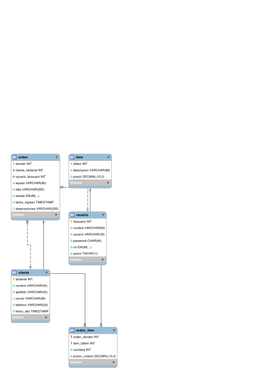

# Sistema de Gestión de Servicio Técnico de PC

Trabajo Práctico Integrador de **Desarrollo Backend III** — Tecnicatura Universitaria en Programación Web, FCEFN, Universidad Nacional de San Juan.

**Autor:** Javier Rojas

Aplicación web Jakarta EE para un servicio técnico de computadoras: clientes, órdenes de reparación, servicios y repuestos con precio, y usuarios con dos roles (administrador y empleado).



## Funcionalidades

| Funcionalidad | Administrador | Empleado |
|---|:---:|:---:|
| Inicio y cierre de sesión | ✅ | ✅ |
| ABM de usuarios (con baja lógica) | ✅ | ❌ |
| ABM de ítems y precios | ✅ | Solo consulta |
| Registrar, editar y buscar clientes (número automático) | ✅ | ✅ |
| Eliminar clientes sin órdenes | ✅ | ❌ |
| Crear órdenes, agregar y quitar ítems, cambiar el estado | ✅ | ✅ |
| Listar órdenes con filtro por estado o cliente y resumen por estado | ✅ | ✅ |

**Reglas de negocio:** contraseñas guardadas con hash SHA-256; cada ítem de una orden guarda el precio del momento; una orden entregada no admite cambios en sus ítems; no se pueden borrar ítems usados ni clientes con órdenes.

## Arquitectura

MVC + Session Facade:

```
Navegador → FiltroAcceso (@WebFilter: sesión y rol)
          → Manejador (Servlet / controlador)
          → Facades (@Stateless EJB, transacciones del contenedor)
          → Entidades JPA + EntityManager (EclipseLink, unidad ServicioPU)
          → jdbc/bdservicio (JNDI) → ServicioPool → MySQL
Manejador → forward → vistas JSP + JSTL en /WEB-INF/vista
```

```
servicioTecnico/src/main/
├── java/
│   ├── controlador/   Manejador.java
│   ├── entidad/       Usuario, Cliente, Item, Orden, OrdenItem, OrdenItemPK
│   ├── seguridad/     FiltroAcceso.java
│   └── sesion/        AbstractFacade y un Facade por entidad
├── resources/META-INF/persistence.xml
└── webapp/
    ├── css/estilos.css
    ├── index.jsp, login.jsp
    └── WEB-INF/vista/  (pantallas y plantilla/encabezado.jspf)
```

## Tecnologías

JDK 21 · Jakarta EE 11 · Eclipse GlassFish 8.0.0 · JPA (EclipseLink) · EJB · Servlets · JSP + JSTL · MySQL 8.0 + Connector/J 8.4 · Maven · NetBeans

## Instalación y ejecución

### 1. Base de datos

Ejecutar `bdservicio.sql` en MySQL Workbench (o desde la terminal):

```bash
mysql -u root -p < bdservicio.sql
```

Crea la base `bdservicio` con datos de prueba.

### 2. Driver y pool de conexiones en GlassFish

```bash
asadmin add-library mysql-connector-j-8.4.0.jar
asadmin restart-domain

asadmin create-jdbc-connection-pool \
  --datasourceclassname com.mysql.cj.jdbc.MysqlDataSource \
  --restype javax.sql.ConnectionPoolDataSource \
  --property user=root:password=root:serverName=localhost:portNumber=3306:databaseName=bdservicio:useSSL=false:allowPublicKeyRetrieval=true:serverTimezone=UTC \
  ServicioPool

asadmin ping-connection-pool ServicioPool
asadmin create-jdbc-resource --connectionpoolid ServicioPool jdbc/bdservicio
```

Ajustar `user` y `password` a la instalación local de MySQL.

### 3. Desplegar

Abrir `servicioTecnico` en NetBeans, elegir GlassFish como servidor y ejecutar **Run**.

Abrir: `http://localhost:8080/servicioTecnico/`

### Usuarios de prueba

| Usuario | Contraseña | Rol |
|---|---|---|
| admin | admin123 | Administrador |
| empleado | empleado123 | Empleado |
